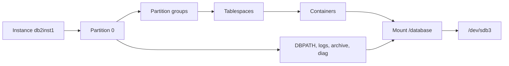

# db2-dpf-physical-map

A bash script that reports the **physical / structural dependency chain** of a Db2 LUW database in a DPF (Database Partitioning Feature) instance where all logical partitions run on the same server.

```
Instance -> Host -> Logical partition (port) -> DB path / Log path / Archive
         -> Storage group paths -> Partition group -> Tablespace
         -> Container -> Filesystem -> Mount / Device
```

The script is **report only**. It runs read-only queries and OS inspection commands, prints what exists, and does not validate, judge or recommend. It writes only a temporary directory under `/tmp` and the report file.

## Requirements

- Db2 LUW 11.5 (developed and run against v11.5.0.0 FP0)
- Linux, with `bash` 4 or later (the script uses process substitution)
- Run as the **Db2 instance owner** with `db2profile` sourced
- A readable `~/sqllib/db2nodes.cfg`
- Standard tools: `awk`, `sed`, `df`, `findmnt`, `lsblk`, `ipcs`, `ss` or `netstat` (missing tools are skipped where possible)
- Authority to query `MON_GET_*`, `ADMIN_GET_STORAGE_PATHS` and `SYSIBMADM.DBPATHS` (the instance owner normally has it)

## Usage

Run it with **bash**, not `sh`:

```bash
chmod +x db2_dpf_physical_map.bash
./db2_dpf_physical_map.bash <DBNAME> [outfile]
# or
bash db2_dpf_physical_map.bash <DBNAME> [outfile]
```

If no output file is given, the report is written to `db2_dpf_map_<DBNAME>_<YYYYmmdd_HHMMSS>.txt` in the current directory and also printed to the terminal.

| Variable | Default | Purpose |
|---|---|---|
| `DB2_QUERY_TIMEOUT` | `60` | Seconds allowed for `db2_ps` in section 7 |

### Exit codes

| Code | Meaning |
|---|---|
| 0 | Clean run: all partitions reachable, no warnings |
| 1 | Run completed with warnings (for example a query failed); all partitions reachable |
| 2 | One or more partitions unreachable, or no partition reachable (run aborted) |
| 3 | `db2nodes.cfg` not readable (not a DPF instance owner shell) |

## What it reports

| Section | Content |
|---|---|
| 1 | Host, instance, `db2level`, `db2nodes.cfg`, FCM ports and logical-port mapping, listening sockets, `db2set -all`, key DBM CFG items |
| 2 | Database directory entry |
| 3 | Partition groups and their partitions |
| 3a | Partition group to tablespace to bufferpool / storage group |
| 3b | Bufferpools and per-partition overrides |
| 3c | Storage groups |
| 4 | Per partition: DB paths, log and archive settings, storage paths, tablespace state and size, container to filesystem to device, filesystem of db / log / archive / diag paths |
| 5 | Filesystem to partitions and objects map |
| 6 | Block device stack (`lsblk`, `findmnt`) |
| 7 | Runtime processes (`db2_ps`, or `ps` fallback) and instance shared memory |
| 8 | Run summary (unreachable partitions, warnings) |

## How partitions are reached

All partitions are on one host, so no node directory is needed. For each logical partition the script sets `DB2NODE`, terminates the CLP back-end, connects, and verifies the result with `values current dbpartitionnum` before running any per-partition query. A partition that cannot be verified is skipped and listed in section 8.

`db2` CLP commands are called directly, not through a `timeout` or shell-function wrapper, because the CLP back-end session is tied to the parent PID of the `db2` command. A wrapper causes `SQL1024N`.

## Example

Run on a Docker test bed (single logical partition). Full output: [`examples/db2_dpf_map_TESTDB_20261102_172439.txt`](examples/db2_dpf_map_TESTDB_20261102_172439.txt).

| Item | Value |
|---|---|
| Host / instance | `db2host` / `db2inst1`, Db2 v11.5.0.0 FP0 |
| `db2nodes.cfg` | `0 db2host 0` |
| Client listener | `db2c_db2inst1`, 50000/tcp |
| Partition groups | `IBMCATGROUP` (P0), `IBMDEFAULTGROUP` (P0), `IBMTEMPGROUP` (no partition rows) |
| Tablespaces | `SYSCATSPACE`, `SYSTOOLSPACE`, `USERSPACE1`, `TEMPSPACE1` |
| Bufferpool | `IBMDEFAULTBP`, AUTOMATIC, 4K |
| Storage group | `IBMSTOGROUP` (default) on `/database/data` |
| Active log | `/database/data/db2inst1/NODE0000/SQL00001/LOGSTREAM0000/` |
| Archive log | `DISK:/database/logs/` |
| Filesystem | `/database`, ext4, 78G, 27% used |
| Device | `/dev/sdb3[/docker-apps/db2-single-dpf/data]` |

Dependency chain for that run:



## Reading the output

- **Device with brackets**: `/dev/sdb3[/docker-apps/...]` is `findmnt` notation for a bind-mounted subtree. The part in brackets is the source directory on the underlying filesystem. In a container it is the host path behind the mount.
- **`lsblk` in a container** can show a device against a file mount (for example `/var/db2/db2nodes.cfg`) instead of the directory mounts, because it lists one mount point per device. Section 6 also prints `findmnt` for every mount Db2 uses.
- **`IBMTEMPGROUP`** can have no rows in `SYSCAT.DBPARTITIONGROUPDEF`; it is shown with `-` in section 3.
- **Bufferpool `NPAGES = -2`** is shown as `AUTOMATIC`.
- **Logical port to FCM service**: port 0 maps to `DB2_<instance>`, port N to `DB2_<instance>_N`, looked up in `/etc/services`.
- **Return codes**: CLP return codes 0 to 2 are treated as success (1 = no rows, 2 = warning). Failures are listed in section 8.

## Tested on

| Environment | Result |
|---|---|
| Db2 v11.5.0.0 FP0, Linux (Docker), 1 logical partition | Works |
| Db2 with 2 or more logical partitions on one host | **Not yet tested** |
| Other Db2 versions, AIX, other Linux distributions | Not tested |

The multi-partition code paths (`DB2NODE` switching, per-partition `NODE000N` paths, the shared-filesystem map in section 5) are written for DPF but have only run against a single partition so far. Reports from other setups are welcome.

## Limitations

- Single host only: all logical partitions must be on the server where the script runs. It does not connect to other hosts.
- Container paths that are not visible from the shell (for example inside a different mount namespace) are listed but not mapped to a filesystem.
- Linux tooling is assumed (`findmnt`, `lsblk`, `df -P`).

## Contributing

Issues and pull requests are welcome. Please include the Db2 version, the OS, the contents of `db2nodes.cfg` (host names can be masked) and the relevant part of the report. Check changes with `bash -n` and `shellcheck` before submitting.

## Disclaimer

This project is not affiliated with, endorsed by or sponsored by IBM. Db2 is a trademark of International Business Machines Corporation. The script is provided as is; review it and test it in a non-production environment before using it on production systems.

## License

Released under the [MIT License](LICENSE). You are free to use, copy, modify, merge, publish, distribute and sell copies of the software, provided the copyright and permission notice are included.
